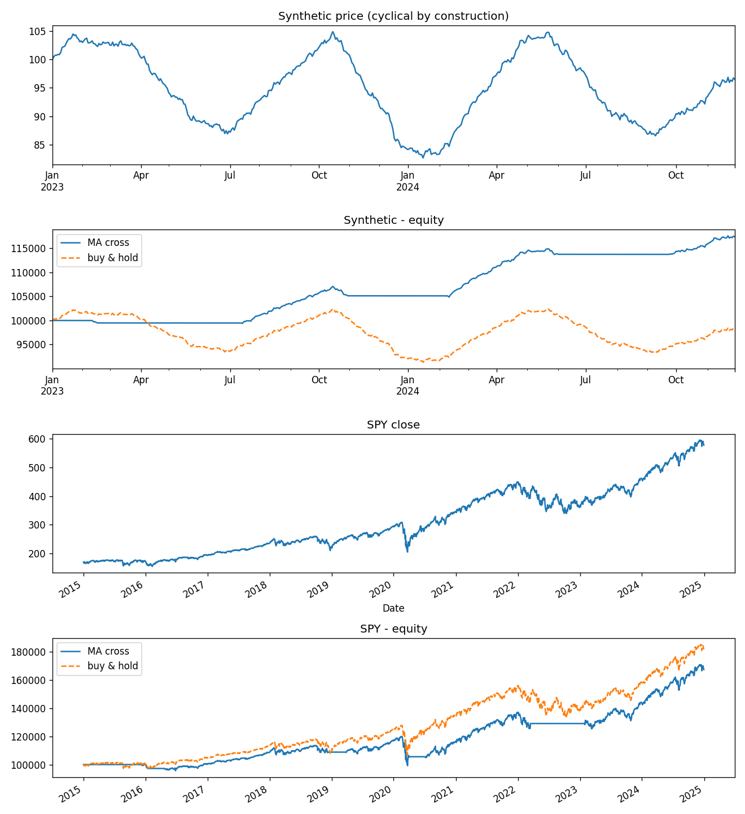
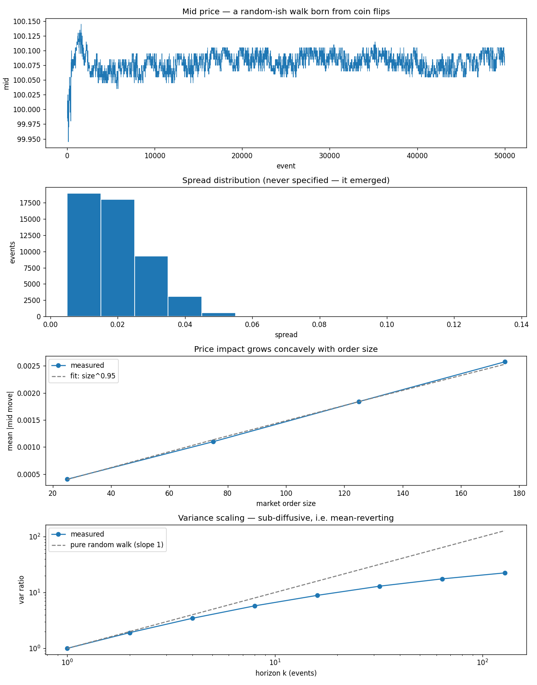

# Market Simulation Stack

**[Live site &rarr;](https://mihircoding.github.io/backtestingEngine/)** — the
equity curves, the trade log, the parameter grid, the emergent order-book
statistics, and a browser port of the matching engine you can send orders to.

Two halves of the same question, in one repository.

**`exchange/`** is a price-time priority matching engine — the piece of
infrastructure that *is* an exchange — plus a zero-intelligence order flow
simulator to run through it. The agents flip coins. The book still produces a
realistic spread distribution, concave price impact, and a mid price that
mean-reverts at short horizons the way real equity data does. None of that was
programmed in; it falls out of the matching rules.

**`src/`** is an event-driven backtester, built the way production trading
systems are built: components that talk to each other only through a queue of
events, one timestamp at a time. No component can see the future, because the
future has not been pushed onto the queue yet.

They were separate projects, and separately they both had the same hole in
them. A backtester has to decide what price your order filled at, and every
backtester in the world decides it with a formula — some basis points, maybe
scaled by order size. An order book does not need a formula. It knows what the
fill was, because it printed it.

**`src/book_execution.py` wires them together**: the backtester's orders go
into the matching engine, and the fill price is the volume-weighted average of
the resting orders the order actually consumed. Cost stops being a parameter
and becomes a consequence of depth.

The first thing that falls out is that the standard assumption is wrong in both
directions. A flat 2 bps on SPY overcharges a small order by a factor of five
and undercharges a 23-million-share order by a factor of fourteen; the two
cross at about 2% of a day's volume — or at 0.4%, or at 7%, depending on where
in the book the depth is assumed to sit, which is a twentyfold error bar on a
number nothing here can observe and the reason the dearest profile is the one
that ships. The second thing only shows up once the
book is allowed to thin when the market gets loud: this strategy's fills land
at the 64th percentile of realized volatility rather than the 50th, so it meets
a book a fifth thinner than it was being charged for, and four fifths of the
extra cost is the timing rather than the size. A moving-average crossover fires
when a trend breaks, and a trend breaking is a volatility event. The third is a
flaw the comparison exposed in the capacity study that was already here — its Sharpe ratio *rises*
above $5bn, because the participation cap stops filling and the statistic ends
up describing idle cash instead of a strategy. The fourth is about the formula
itself: it charges a square root of each *slice's* share of volume, so once an
order is sliced it costs the same per share at any size, and the law it is
named after says otherwise. A book that keeps a third of what each slice moved
reproduces that law in both exponent (0.48) and coefficient (0.49) — which
is to say the matching engine, given one parameter, produces the empirical
impact law that the formula only cites. Give the formula the law's form
(`impact_on="order"`) and it lands on that book at $1bn — 0.57 Sharpe against
0.57, 15 bps a slice against 16 — and the reason turns out to be the
coefficient rather than the slicing: at $1bn every order fits in a bar or
two, and the shipped Y of 1 is twice the empirical value. Above that the two
come apart, because the order takes a month to fill and a law measured on
completed metaorders has nothing to say about one that is still working. The
fifth is a correction to the third: the "deployed" column that said 98% of a
$100bn book never reached the market was measuring the last order of the
sample — a sell, two bars old when the data ran out. Averaged over every bar
the $100bn book was in the market as much as the $100m one. It was not idle,
it was stuck, taking 161 bars to build a position and 161 to sell it, and
the Sharpe that rose with AUM was a seven-month-lagged buy-and-hold with the
strategy's costs. Give the portfolio a liquidity budget — hold only what 10%
participation can fill in five days — and every order completes, the Sharpe
stops rising, and capacity becomes a patience: $12bn at a week's, $2.4bn at
a day's, with the return on AUM falling as 1/AUM above it. The sixth makes
the budget bind on the way out as well — a desk that cannot get out in five
days does not own the position — and finds it costs a third of the return
at $20bn to shorten the worst exit from 16 bars to 13, because a trim is an
order into the same thin tape; and runs the rule that flips, whose reversal
takes twice as long below the budget and has no capacity worth measuring,
because on this tape the short leg has no edge to scale.
[RESULTS.md](RESULTS.md) has all of it, and the corrections.

375 tests.

```bash
pip install -r requirements.txt
python -m pytest -q                 # 375 passed

# the two halves together
python fill_realism.py              # fill models compared, the headline result

# the strategy side
python run_backtest.py              # synthetic + SPY, writes engine_backtest.png
python run_backtest.py --walk-forward    # refit the windows yearly, trade out of sample
python run_backtest.py --capacity        # how much money it holds, at 10% of volume
python run_backtest.py --significance    # bootstrap error bars, deflate the grid's best cell
python cross_section.py             # the same rule across 24 assets
python long_short.py                # and with a short leg, which makes it worse

# the venue side
python run_simulation.py            # 50k events, writes simulation.png
python benchmark.py                 # throughput and latency
python queue_study.py               # what a place in the queue is worth
python latency_study.py             # what a 15us disadvantage costs a market maker
python auction_study.py             # the opening auction, where the rules differ
```




## Layout

```
src/              the backtester: events, data handler, strategy, portfolio, execution
  book_execution.py   the bridge — execution that asks exchange/ what the fill was
exchange/         the matching engine: order book, order types, fees, latency, auction
tests/            backtester tests
  exchange/       matching engine tests
notes/            the two long write-ups, and the interview notes for each
RESULTS.md        the result that needs both halves
```

## Results

| | |
|---|---|
| [RESULTS.md](RESULTS.md) | fills simulated vs. assumed, and what the capacity study got wrong |
| [notes/backtester.md](notes/backtester.md) | costs, significance, walk-forward, sizing, capacity, 24 assets, long/short |
| [notes/exchange.md](notes/exchange.md) | spread, impact, mean reversion, fees, latency, auctions, queue value |
| [notes/interview-backtester.md](notes/interview-backtester.md) | how to talk about the strategy side |
| [notes/interview-exchange.md](notes/interview-exchange.md) | how to talk about the microstructure side |

The short version of all of it: the 50/200 moving-average rule loses to buy and
hold on SPY, loses across 24 assets, loses worse with a short leg added, and
does not survive an honest walk-forward. Those write-ups lead with that rather
than with the best cell of the parameter grid, and the engine exists to make
the negative result trustworthy rather than to find a positive one.

---

## How the two halves work

### The matching engine

An order book is two sorted collections of resting limit orders — bids below,
asks above — and the gap between the best of each is the **spread**. Everything
else is bookkeeping.

```
         asks (sellers)          Someone willing to sell at 101.00
  101.00 |████ 300              is offering; someone willing to buy
  100.60 |██ 150                at 100.50 is bidding. Nothing trades
  100.50 |█ 100     <- best ask  until one side reaches across.
  ---------------------- spread = 0.05
  100.45 |██ 200    <- best bid
  100.40 |████ 400
  100.30 |███ 250
         bids (buyers)
```

Two orders at the same price are not the same order. The one that arrived first
fills first, which is **price-time priority**, and section 8 of
notes/exchange.md prices what that priority is worth to the trader holding it.

### The event-driven backtester

The natural way to backtest in pandas is **vectorized**: compute a signal
column, shift it, multiply by a returns column, take a cumulative product. It
is fast and fine for research, and it has three structural problems.

- **Lookahead is one typo away.** The entire price series exists in memory as a
  column. Forget a `.shift(1)` and you are trading on a close you could not
  have known. Nothing crashes; your Sharpe just quietly triples.
- **Order handling does not map to column arithmetic.** Partial fills, limit
  orders, stops, position limits, latency — none of these are expressible as
  elementwise operations on a Series.
- **The research code looks nothing like the live code.** Going to production
  means a rewrite, and a rewrite means a fresh set of bugs in the one place you
  can least afford them.

The event-driven alternative is a queue. A `MarketEvent` releases one bar. The
strategy sees it and may emit a `SignalEvent`. The portfolio turns that into a
sized `OrderEvent`. The execution handler turns that into a `FillEvent`. Each
component can only read what has already been released, so lookahead is not
something to be careful about — it is unrepresentable.

### Why that matters for the bridge

Because the execution handler is just another component behind the queue,
swapping the one that applies a formula for the one that routes into a real
matching engine changes nothing else in the system. Four handlers now exist —
same-bar close, next-bar open, participation-limited, and the book — and they
differ in how the fill price is formed and in nothing else. That is what makes
them comparable, and comparability is the only reason the numbers in RESULTS.md
mean anything.
